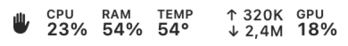
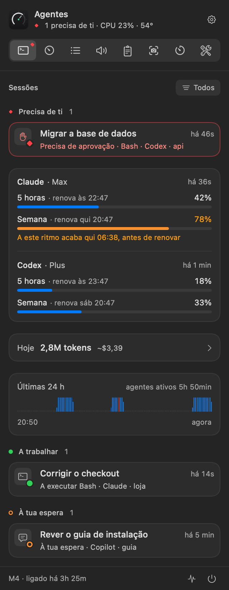
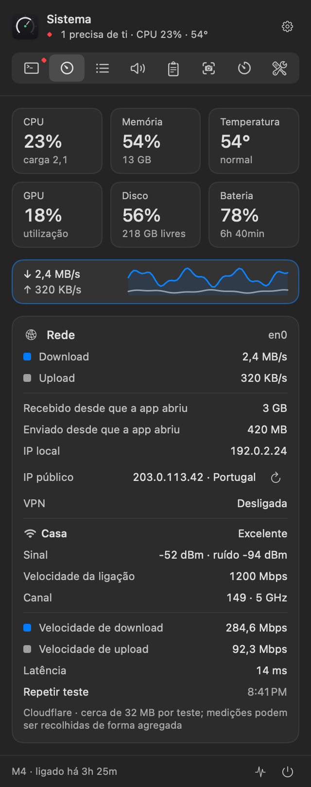
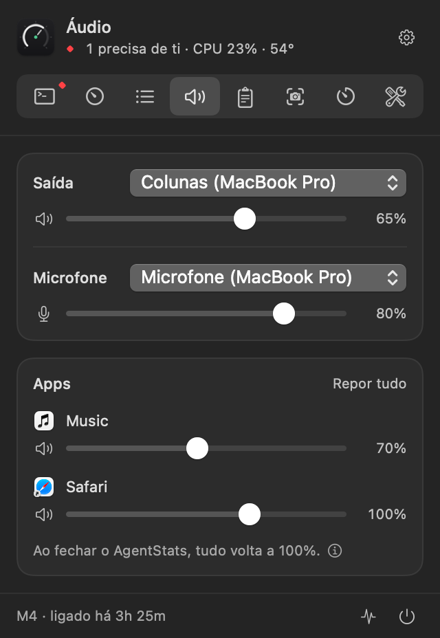
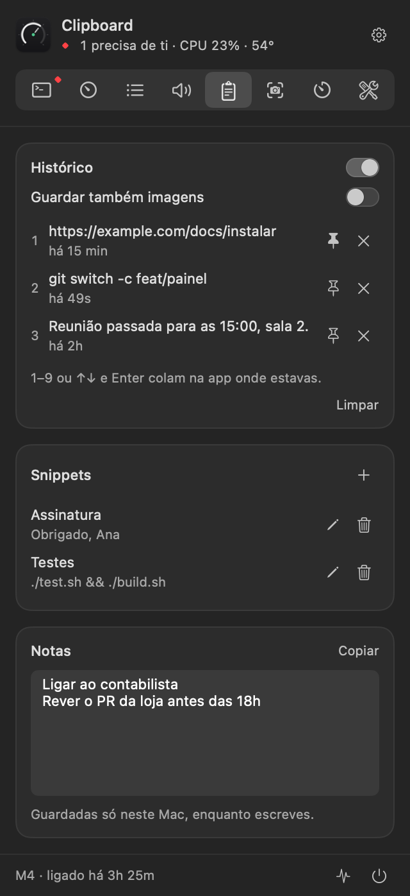
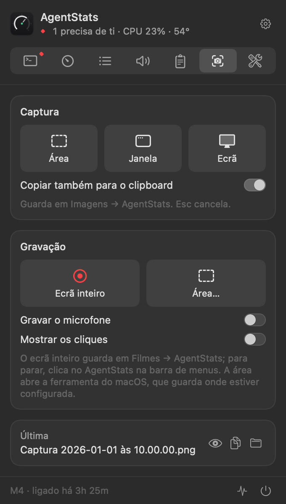
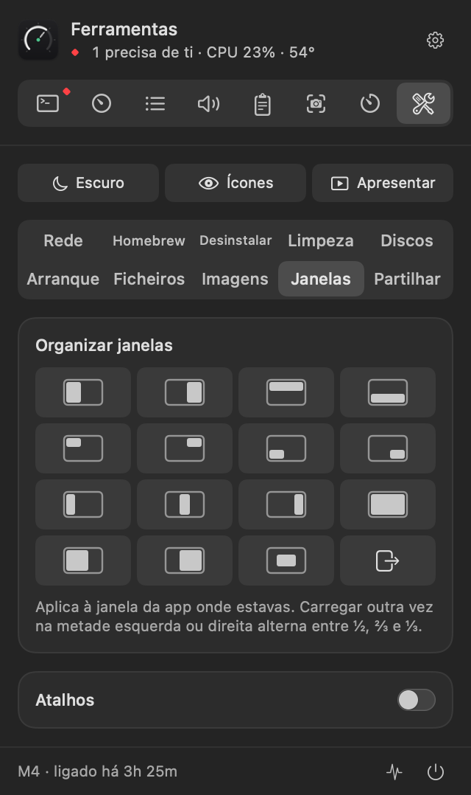

# AgentStats

[Português](README.md) · [English](README.en.md) · [Español](README.es.md) · [Français](README.fr.md)


**AI agents and Mac metrics in one panel.** AgentStats lives in the macOS menu bar and shows what is running, what needs your attention, and how your system resources are doing.

**[Download the latest release](https://github.com/HamiltonPrado/agentstats/releases/latest)** · [Website](https://hamiltonprado.github.io/agentstats) · [Report an issue](https://github.com/HamiltonPrado/agentstats/issues)

<p align="center">
  
</p>

<p align="center">
  
  
  
</p>

<p align="center">
  
  
  
</p>

<p align="center"><sub>Screenshots use demo data. The interface is in Portuguese.</sub></p>

## What you can monitor

### AI agents

- Sessions with project, model, subagents, and status: working, waiting, or needing approval. Click one to return to the app where it runs.
- Recognizes Claude Code, Codex, Copilot, Cursor Agent, OpenCode, Antigravity, Aider, Goose, Gemini CLI, and Amp. Detail depends on what each one logs on your Mac.
- **Plan limits** for Claude and Codex, with reset times.
- **Tokens and estimated API cost** by session, day, and project for Claude Code, Codex, Copilot, and OpenCode. Cost appears only for models with known prices and is not what you pay on a subscription.
- Notifications when a long task finishes or an agent needs you, with reminders while it keeps waiting.

### System and processes

- CPU, memory, GPU, temperatures, network, disk, and battery, with up to 7 days of history and alerts.
- Apps using the most energy, heaviest processes, and largest folders.
- Manual speed test through Cloudflare: about **32 MB per test**; measurements may be collected in aggregate.
- Does not control fans.

### Audio

- Choose output and microphone and adjust their volume.
- **Per-app mixer**, 0 to 150% (macOS 14.2+). It only touches apps you adjust and returns to 100% when AgentStats quits.

### Clipboard

- Text history, **off until you turn it on**: 100 items, 7 days, with pins and snippets.
- Skips what password managers mark as secret and known API key formats. History stays on this Mac, **unencrypted**.

### Capture

- Capture an area, a window, or the screen, and record the full screen with optional microphone and clicks. Area recording opens the macOS tool.

### Tools

- **Ports:** see what is listening and stop your own processes, with confirmation.
- **Homebrew:** upgrade and remove packages.
- **Uninstall:** move apps to the Trash, with the leftovers you select.
- **Cleanup:** moves caches from a closed list to the Trash (Homebrew, pip, and npm; Brave, Playwright, Hugging Face, and npx are optional), with confirmation and without touching anything detected as in use. Space is freed when you empty the Trash.

### Make it yours

Configurable menu bar, global shortcut, profiles, theme, color, width, text size, keep awake, launch at login, and support for VoiceOver and Reduce Motion.

## Permissions and privacy

| Feature | Permission macOS may request |
| --- | --- |
| Notifications and alerts | Notifications |
| Per-app mixer | System audio recording |
| Capture and recording | Screen recording |
| Recording with microphone | Microphone |
| Clipboard history | Paste from other apps (macOS 15.4+) |
| Disk categories, measured when the card opens | Personal folders (Desktop, Documents, Downloads, Music, Pictures) |

There is no account and no telemetry. AgentStats reads agent logs on your Mac and does not send them. The network is used only by the speed test, by Homebrew when you use it, and by the periodic limits check made through your Claude Code.

The app has no Developer ID, so **macOS may ask for these permissions again after each update**.

## Requirements

Apple Silicon Mac with macOS 14 or later. Tested on macOS 27.2.

## Install

With [Homebrew](https://brew.sh):

```bash
brew tap hamiltonprado/agentstats https://github.com/HamiltonPrado/agentstats
brew trust hamiltonprado/agentstats
brew install --cask agentstats
```

Update with `brew upgrade --cask agentstats`. Remove with `brew uninstall --cask agentstats` (add `--zap` to also delete settings and history). The app is not notarized by Apple: the cask removes the quarantine flag on install, so it opens without the macOS warning.

Or by hand:

1. Download **AgentStats.zip** from the [latest release](https://github.com/HamiltonPrado/agentstats/releases/latest).
2. Unzip it and move `AgentStats.app` to your Applications folder.
3. Open the app. If macOS blocks the first launch, go to **System Settings → Privacy & Security → Open Anyway**. The app is locally signed and does not have an Apple Developer signature.

You can also install from the command line with the [GitHub CLI](https://cli.github.com):

```bash
tmp=$(mktemp -d) && gh release download --repo HamiltonPrado/agentstats --pattern AgentStats.zip --dir "$tmp" && ditto -x -k "$tmp/AgentStats.zip" "$tmp" && { pkill -x AgentStats 2>/dev/null || true; ditto "$tmp/AgentStats.app" /Applications/AgentStats.app && open /Applications/AgentStats.app; }
```

## Contribute

Requires macOS 14 or later and the Xcode Command Line Tools.

```bash
./build.sh
open build/AgentStats.app
```

Run the tests with:

```bash
./test.sh
```

Contributions are welcome. Open an [issue](https://github.com/HamiltonPrado/agentstats/issues) to report a problem or suggest an improvement.

## License

AgentStats is distributed under the [MIT License](LICENSE). You may use, modify, and redistribute the code under its terms.

<details>
<summary>Development details</summary>

### Creating a release

Update `VERSION`, then push a tag with the same version, for example:

```bash
git tag v1.17
git push origin v1.17
```

GitHub Actions checks the version, runs the tests, builds the app, and publishes `AgentStats.zip` to the release.

### Diagnostics

- `AgentStats --dump` — system metrics and detected agents.
- `AgentStats --bench` — reader execution times.
- `AgentStats --snapshot <folder>` — renders panel screenshots as PNG files, using demo data only.
- `AgentStats --smoke` — launch test with the real readers.
- `AGENTSTATS_DISABLE=icon,temps,procs,sessions,usage,energy,limits,gpu,disk` — disables readers for performance measurements.

### Architecture

The `Sampler` actor coordinates data collection and returns an immutable sample. `Monitor` applies the sample on the main actor; SwiftUI views observe only the state they use. The project uses Swift 6 concurrency checking.

</details>
