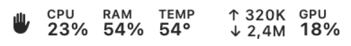
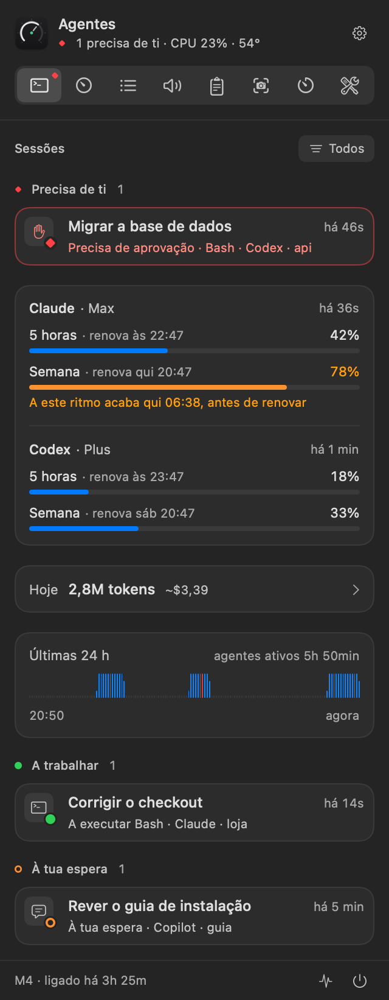
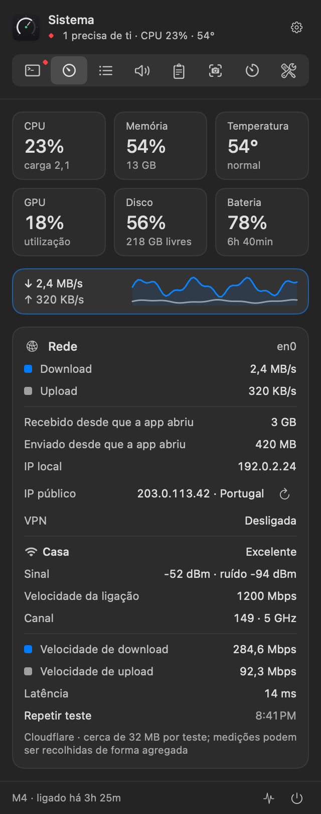
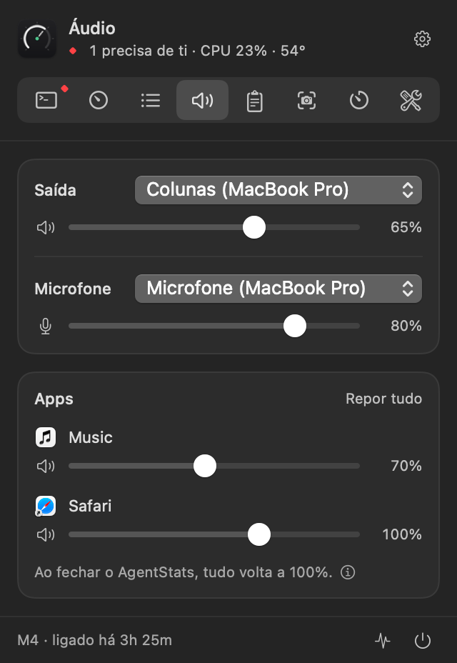
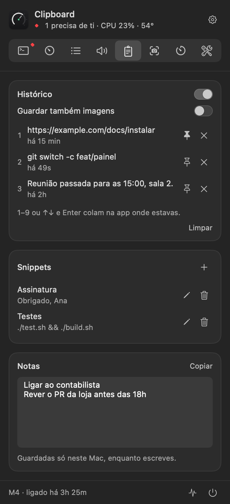
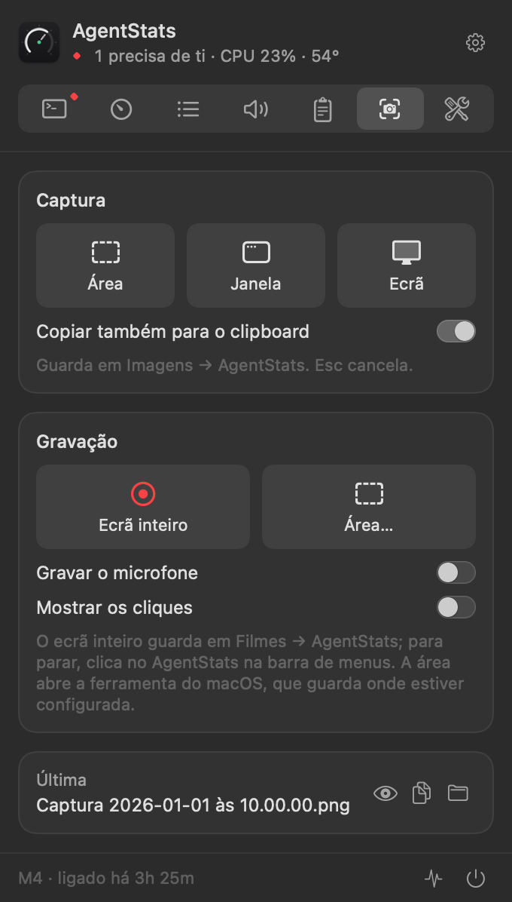
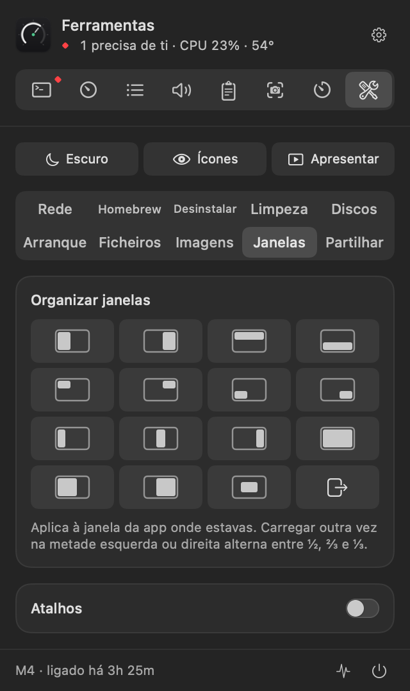

# AgentStats

[Português](README.md) · [English](README.en.md) · [Español](README.es.md) · [Français](README.fr.md)


**Agentes de IA y métricas del Mac en un solo panel.** AgentStats vive en la barra de menús de macOS y muestra qué se está ejecutando, qué requiere tu atención y cómo están los recursos del sistema.

**[Descargar la última versión](https://github.com/HamiltonPrado/agentstats/releases/latest)** · [Sitio web](https://hamiltonprado.github.io/agentstats) · [Informar de un problema](https://github.com/HamiltonPrado/agentstats/issues)

<p align="center">
  
</p>

<p align="center">
  
  
  
</p>

<p align="center">
  
  
  
</p>

<p align="center"><sub>Capturas con datos de demostración. La interfaz está en portugués.</sub></p>

## Qué puedes supervisar

### Agentes de IA

- Sesiones con proyecto, modelo, subagentes y estado: trabajando, esperando o pendiente de aprobación. Haz clic en una para volver a la app donde se ejecuta.
- Reconoce Claude Code, Codex, Copilot, Cursor Agent, OpenCode, Antigravity, Aider, Goose, Gemini CLI y Amp. El detalle depende de lo que registre cada uno en el Mac.
- **Límites del plan** de Claude y Codex, con la hora de renovación, avisos al 75% (o el valor que elijas), al 90% y al renovarse, y cuándo se agotan a este ritmo.
- **Conexión con Claude Code en un clic** (Ajustes → General): las solicitudes de aprobación llegan al momento, en vez de deducirse de los procesos.
- **Tokens y coste estimado de API** por sesión, día y proyecto para Claude Code, Codex, Copilot y OpenCode. El coste solo aparece con modelos de precio conocido y no es lo que pagas con una suscripción.
- Avisos cuando termina una tarea larga o un agente te necesita, con recordatorios si sigue esperando.

### Sistema y procesos

- CPU, memoria, GPU, temperaturas, red, disco y batería, con historial de hasta 7 días y alertas.
- Los 5 procesos que más CPU y memoria consumen, que se cierran con el botón derecho. En la batería: las apps que más energía gastaron desde que se desconectó, y la salud y los ciclos a lo largo de los meses.
- Apps que más energía gastan, procesos más pesados y carpetas más grandes.
- Disco por categorías, con los colores y las unidades de macOS. Se mide por carpetas al abrir la tarjeta, así que es aproximado.
- Prueba de velocidad manual con Cloudflare: unos **32 MB por prueba**; las mediciones pueden recopilarse de forma agregada.
- Wi-Fi: calidad de la señal, ruido, velocidad de enlace y canal. El nombre de la red solo aparece si das acceso a la Localización, que macOS exige para ello; la app no pide tu ubicación.
- Aviso de versión nueva en el panel y por notificación, con el comando de Homebrew si la instalaste así. Consulta GitHub una vez al día y se desactiva en Ajustes.
- No controla los ventiladores.

### Audio

- Elige la salida y el micrófono y ajusta su volumen.
- **Mezclador por app**, de 0 a 150% (macOS 14.2+). Solo modifica las apps que ajustes y vuelve al 100% al cerrar AgentStats.

### Portapapeles

- Historial de texto, **desactivado hasta que lo actives**: 100 elementos, 7 días, con fijados y fragmentos.
- Ignora lo que los gestores de contraseñas marcan como secreto y los formatos conocidos de claves de API. El historial se queda en este Mac, **sin cifrar**.

### Captura

- Captura un área, una ventana o la pantalla, y graba la pantalla completa con micrófono y clics opcionales. Para grabar un área se abre la herramienta de macOS.

### Herramientas

- **Red:** ve los puertos a la escucha y cierra procesos tuyos, con confirmación, y vacía la caché de DNS (pide la contraseña de administrador en el diálogo de macOS).
- **Discos:** expulsa discos externos, imágenes de disco y volúmenes de red, y dice qué app impide expulsarlos.
- **Arranque:** lo que se abre solo (LaunchAgents y LaunchDaemons). Los tuyos se pueden desactivar y volver a activar; los demás solo se muestran.
- **Archivos:** los archivos más grandes de tu carpeta personal, con la fecha de la última apertura y un filtro para los que llevan más de 6 meses sin uso. Los mueve a la Papelera con confirmación.
- **Homebrew:** actualiza y elimina paquetes.
- **Desinstalar:** mueve apps a la Papelera, con los restos que elijas.
- **Limpieza:** mueve a la Papelera cachés de una lista cerrada (Homebrew, pip y npm; Brave, Playwright, Hugging Face y npx son opcionales), con confirmación y sin tocar lo que detecte en uso. El espacio se libera al vaciar la Papelera.
- **Teclado y pantalla:** bloquea el teclado y deja la pantalla en negro para limpiarlos. Se sale con un botón, con las dos teclas ⌘ o automáticamente tras 1, 2 o 5 minutos. El botón de encendido y Touch ID no se pueden bloquear.

### A tu medida

Barra de menús configurable, pestañas a tu elección (cuáles, en qué orden y cuál se abre), atajos ⌥⌘1 a ⌥⌘7 para cada una, límites de alerta con cualquier valor, atajo global, perfiles, tema, color, ancho, tamaño del texto, mantener el Mac activo (por tiempo o mientras haya agentes trabajando), inicio automático y compatibilidad con VoiceOver y “Reducir movimiento”.

## Permisos y privacidad

| Función | Permiso que puede pedir macOS |
| --- | --- |
| Avisos y alertas | Notificaciones |
| Mezclador por app | Grabación del audio del sistema |
| Captura y grabación | Grabación de pantalla |
| Grabar con micrófono | Micrófono |
| Limpieza del teclado y la pantalla | Accesibilidad |
| Historial del portapapeles | Pegar desde otras apps (macOS 15.4+) |
| Categorías del disco, medidas al abrir la tarjeta | Carpetas personales (Escritorio, Documentos, Descargas, Música, Imágenes) |
| Nombre de la red Wi-Fi (opcional) | Localización |

No hay cuenta ni telemetría. AgentStats lee los registros de los agentes en el Mac y no los envía. Solo usan la red la prueba de velocidad, Homebrew cuando lo utilizas, la consulta periódica de límites mediante tu Claude Code y la búsqueda diaria de versiones nuevas en GitHub, que puedes desactivar.

A partir de la 1.18.1 la app tiene una firma fija, para que **los permisos se mantengan entre actualizaciones**. Si vienes de una versión anterior debes concederlos una última vez: si alguno aparece activado y no funciona, quita AgentStats de esa lista con − y vuelve a añadirlo.

## Requisitos

Mac con Apple Silicon y macOS 14 o posterior. Probada en macOS 27.2.

## Instalación

Con [Homebrew](https://brew.sh):

```bash
brew tap hamiltonprado/agentstats https://github.com/HamiltonPrado/agentstats
brew trust hamiltonprado/agentstats
brew install --cask agentstats
```

Para actualizar, `brew upgrade --cask agentstats`. Para eliminarla, `brew uninstall --cask agentstats` (añade `--zap` para borrar también los ajustes y el historial). La app no está notarizada por Apple: el cask quita la cuarentena al instalar, así que se abre sin el aviso de macOS.

O a mano:

1. Descarga **AgentStats.zip** desde la [última versión](https://github.com/HamiltonPrado/agentstats/releases/latest).
2. Descomprímelo y mueve `AgentStats.app` a la carpeta Aplicaciones.
3. Abre la app. Si macOS bloquea el primer inicio, ve a **Ajustes del Sistema → Privacidad y seguridad → Abrir igualmente**. La app usa un certificado propio, no una firma de desarrollador de Apple.

También puedes instalarla desde la línea de comandos con [GitHub CLI](https://cli.github.com):

```bash
tmp=$(mktemp -d) && gh release download --repo HamiltonPrado/agentstats --pattern AgentStats.zip --dir "$tmp" && ditto -x -k "$tmp/AgentStats.zip" "$tmp" && { pkill -x AgentStats 2>/dev/null || true; ditto "$tmp/AgentStats.app" /Applications/AgentStats.app && open /Applications/AgentStats.app; }
```

## Contribuir

Requiere macOS 14 o posterior y las herramientas de línea de comandos de Xcode.

```bash
./build.sh
open build/AgentStats.app
```

Ejecuta las pruebas con:

```bash
./test.sh
```

Las contribuciones son bienvenidas. Abre una [incidencia](https://github.com/HamiltonPrado/agentstats/issues) para informar de un problema o proponer una mejora.

## Licencia

AgentStats se distribuye bajo la [licencia MIT](LICENSE). Puedes usar, modificar y redistribuir el código según sus términos.

<details>
<summary>Detalles de desarrollo</summary>

### Crear una versión

Solo la primera vez, el propietario del repositorio ejecuta `Scripts/setup-signing.sh` para crear la clave de firma. Después actualiza `VERSION` y envía una etiqueta con la misma versión, por ejemplo:

```bash
git tag v1.18.1
git push origin v1.18.1
```

GitHub Actions comprueba la versión, ejecuta las pruebas, compila la app y publica `AgentStats.zip` en la versión.

### Diagnóstico

- `AgentStats --dump` — métricas del sistema y agentes detectados.
- `AgentStats --bench` — tiempos de ejecución de los lectores.
- `AgentStats --snapshot <carpeta>` — genera capturas del panel en PNG, solo con datos de demostración.
- `AgentStats --smoke` — prueba de arranque con los lectores reales.
- `AGENTSTATS_DISABLE=icon,temps,procs,sessions,usage,energy,limits,gpu,disk` — desactiva lectores para medir el rendimiento.

### Arquitectura

El actor `Sampler` coordina las lecturas y devuelve una muestra inmutable. `Monitor` aplica la muestra en el actor principal; las vistas de SwiftUI solo observan el estado que utilizan. El proyecto usa la comprobación de concurrencia de Swift 6.

</details>
