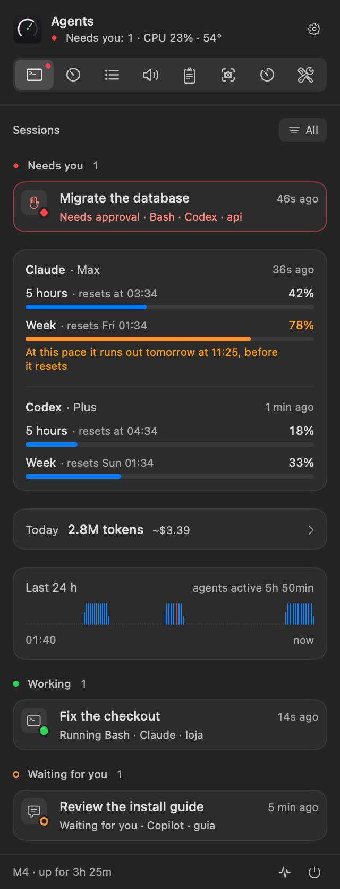
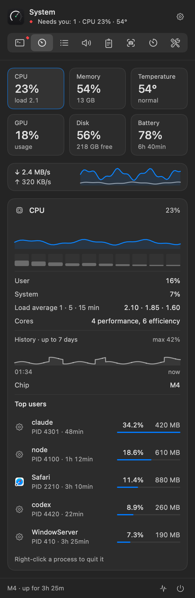
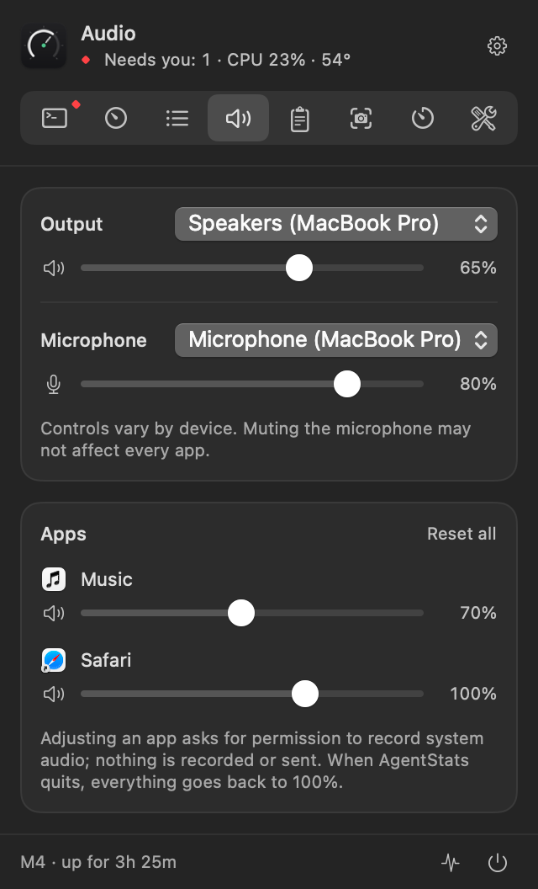
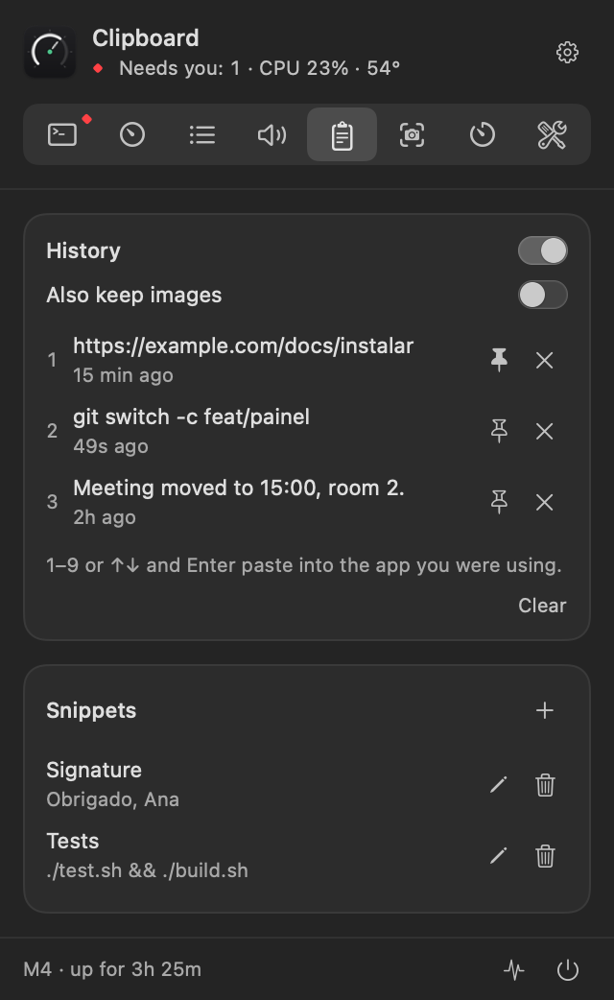
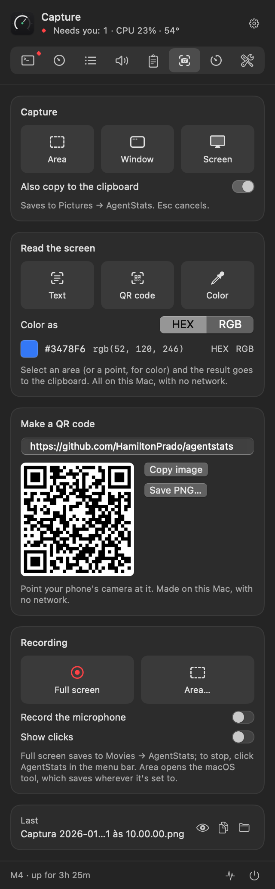
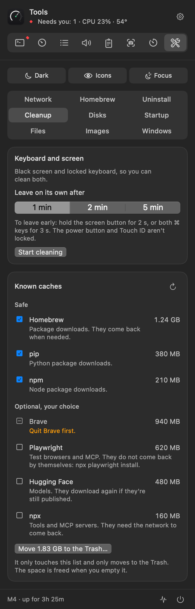

# AgentStats

[Português](README.md) · [English](README.en.md) · [Español](README.es.md) · [Français](README.fr.md)


**Agents IA et indicateurs du Mac dans un seul panneau.** AgentStats se trouve dans la barre des menus de macOS et indique ce qui fonctionne, ce qui demande votre attention et l’état des ressources système.

**[Télécharger la dernière version](https://github.com/HamiltonPrado/agentstats/releases/latest)** · [Site web](https://hamiltonprado.github.io/agentstats) · [Signaler un problème](https://github.com/HamiltonPrado/agentstats/issues)

<p align="center">
  
</p>

<p align="center">
  
  
  
</p>

<p align="center">
  
  
  
</p>

<p align="center"><sub>Captures avec des données de démonstration.</sub></p>

## Ce que vous pouvez surveiller

### Agents IA

- Sessions avec projet, modèle, sous-agents et état : en cours, en attente ou en attente d’approbation. Cliquez sur une session pour revenir à son application.
- Reconnaît Claude Code, Codex, Copilot, Cursor Agent, OpenCode, Antigravity, Aider, Goose, Gemini CLI et Amp. Le détail dépend de ce que chacun enregistre sur le Mac.
- **Limites du forfait** Claude et Codex, avec l’heure de renouvellement, des alertes à 75 % (ou le seuil choisi), à 90 % et au renouvellement, et le moment où elles s’épuisent à ce rythme.
- **Connexion à Claude Code en un clic** (Réglages → Général) : les demandes d’approbation arrivent aussitôt au lieu d’être déduites des processus.
- **Tokens et coût API estimé** par session, jour et projet pour Claude Code, Codex, Copilot et OpenCode. Le coût n’apparaît que pour les modèles au prix connu et ne correspond pas au prix d’un abonnement.
- Notifications à la fin d’une tâche longue ou quand un agent a besoin de vous, avec rappels s’il attend encore.
- **Budget de coût** par jour ou par semaine, avec alerte à 80 % et à 100 %, **résumé hebdomadaire** par notification et **export de l’utilisation en CSV**.

### Système et processus

- Processeur, mémoire, GPU, températures, réseau, disque et batterie, avec historique jusqu’à 7 jours et alertes.
- Les 5 processus qui consomment le plus de processeur et de mémoire, à quitter d’un clic droit. Sur batterie : les apps qui ont le plus consommé depuis le débranchement, et la santé et les cycles au fil des mois.
- Applications les plus énergivores, processus les plus lourds et dossiers les plus volumineux.
- Disque par catégories, avec les couleurs et les unités de macOS. Il est mesuré par dossiers à l’ouverture de la carte, donc approximatif.
- Test de débit manuel via Cloudflare : environ **32 Mo par test** ; les mesures peuvent être collectées sous forme agrégée.
- Wi-Fi : qualité du signal, bruit, débit de liaison et canal. Le nom du réseau n’apparaît que si vous autorisez la Localisation, que macOS exige pour cela ; l’app ne demande jamais votre position.
- IP publique (seulement quand vous cliquez sur « Voir », via Cloudflare) et VPN active. Batterie des AirPods, de la souris, du clavier et d’autres accessoires Bluetooth.
- Avis de nouvelle version dans le panneau et par notification, avec la commande Homebrew si vous l’avez installée ainsi. Consulte GitHub une fois par jour et se désactive dans les Réglages.
- Ne contrôle pas les ventilateurs.

### Audio

- Choisissez la sortie et le micro et réglez leur volume.
- **Mixeur par application**, de 0 à 150 % (macOS 14.2+). Il ne modifie que les applications réglées et revient à 100 % à la fermeture d’AgentStats.
- **Couper le micro** avec un raccourci global (⌃⌥M par défaut), pour les appels, avec une icône rouge dans la barre des menus tant qu’il est coupé.

### Presse-papiers

- Historique de texte, **désactivé tant que vous ne l’activez pas** : 100 éléments, 7 jours, avec épingles et extraits.
- Ignore ce que les gestionnaires de mots de passe marquent comme secret et les formats connus de clés API. L’historique reste sur ce Mac, **non chiffré**.
- **Collage rapide :** 1–9, ou ↑↓ et Entrée, collent un élément dans l’app où vous étiez (nécessite l’Accessibilité ; sinon, il est seulement copié).
- **Images dans l’historique** (optionnel, désactivé par défaut) : captures et images copiées, jusqu’à 30, avec « Enregistrer en PNG… ».

### Capture

- Capturez une zone, une fenêtre ou l’écran et enregistrez l’écran entier, avec micro et clics en option. L’enregistrement d’une zone ouvre l’outil de macOS.
- **Lire l’écran :** copiez le texte d’une zone (OCR), lisez les codes QR et prélevez la couleur de n’importe quel point en HEX ou RVB. Tout sur ce Mac, sans réseau.
- **Générer un code QR** à partir d’un lien ou d’un texte pour l’ouvrir sur le téléphone, et **convertir le dernier enregistrement en GIF** léger pour les PR et les messages.

### Temps

- Minuteur et **Pomodoro** (25 + 5 min, longue pause toutes les 4), avec le temps dans la barre des menus et une alerte à la fin.
- **Horloge mondiale** avec les villes de votre choix, le décalage horaire et si c’est déjà demain là-bas.

### Outils

- **Fenêtres :** placez la fenêtre au premier plan en moitiés, tiers, deux tiers, coins, plein écran ou au centre, et passez-la sur l’autre écran, avec des raccourcis globaux (⌃⌥ + flèches et lettres, comme dans Rectangle) désactivables. Appuyer de nouveau sur la moitié gauche ou droite alterne entre ½, ⅔ et ⅓. Nécessite l’Accessibilité.
- **Raccourcis rapides :** mode sombre, masquer les icônes du bureau (le Finder redémarre) et Ne pas déranger, qui nécessite un raccourci de ce nom dans l’app Raccourcis.
- **Réseau :** voyez les ports à l’écoute et quittez vos processus, après confirmation, et videz le cache DNS (demande le mot de passe administrateur dans la fenêtre de macOS).
- **Disques :** éjectez disques externes, images disque et volumes réseau, et voyez quelle app empêche l’éjection.
- **Démarrage :** ce qui démarre tout seul (LaunchAgents et LaunchDaemons). Les vôtres se désactivent et se réactivent ; les autres sont seulement affichés.
- **Fichiers :** les plus gros fichiers de votre dossier personnel, avec la date de dernière ouverture et un filtre pour ceux inutilisés depuis plus de 6 mois. Mise à la Corbeille après confirmation.
- **Homebrew :** met à jour et supprime des paquets.
- **Désinstaller :** place les applications dans la Corbeille, avec les restes choisis.
- **Nettoyage :** place dans la Corbeille des caches d’une liste fermée (Homebrew, pip et npm ; Brave, Playwright, Hugging Face et npx sont optionnels), après confirmation et sans toucher à ce qui est détecté en cours d’utilisation. L’espace est libéré quand vous videz la Corbeille.
- **Clavier et écran :** verrouille le clavier et affiche un écran noir pour les nettoyer. Sortie par un bouton, les deux touches ⌘ ou automatiquement après 1, 2 ou 5 minutes. Le bouton d’alimentation et Touch ID ne peuvent pas être bloqués.
- **Images :** déposez des photos pour convertir HEIC, PNG ou JPG en JPG ou PNG, réduire la taille et compresser, sans la localisation des photos. Et vidéo en GIF.

### À votre mesure

Barre des menus configurable, onglets au choix (lesquels, dans quel ordre et lequel s’ouvre), raccourcis ⌥⌘1 à ⌥⌘8 pour chacun, seuils d’alerte à n’importe quelle valeur, raccourci global, profils, thème, couleur, largeur, taille du texte, maintien en éveil (pour une durée ou tant que des agents travaillent), lancement automatique et prise en charge de VoiceOver et de « Réduire les animations ». L’interface est en anglais et en portugais : elle suit la langue du Mac, ou choisissez-la dans Réglages → Général.

Il se comporte comme les autres icônes de la barre des menus : le clic droit ouvre un menu avec les onglets, les raccourcis rapides, les Réglages et Quitter, et cliquer hors du panneau, y compris sur le bureau, le ferme.

Dans le panneau : ⌘1–8 changent d’onglet, ⌘[ et ⌘] vont au précédent et au suivant, ⌘, ouvre les Réglages (dans leur propre fenêtre, avec export et import vers un autre Mac) et ⌘W ferme.

### Commandes `agentstats://`

Pour l’app Raccourcis (action « Ouvrir l’URL ») ou le Terminal (`open "agentstats://…"`) :

| Commande | Effet |
| --- | --- |
| `agentstats://open/system` | Ouvre le panneau sur un onglet (`agents`, `system`, `processes`, `audio`, `clipboard`, `capture`, `time`, `tools`) |
| `agentstats://settings` | Ouvre les Réglages |
| `agentstats://timer?minutes=25` · `agentstats://pomodoro` · `agentstats://timer/stop` | Minuteur |
| `agentstats://read/text` · `read/qr` · `read/color` | Lire l’écran |
| `agentstats://toggle/dark-mode` · `toggle/desktop-icons` | Raccourcis rapides |
| `agentstats://usage/copy` | Copie les tokens et le coût du jour et de la semaine |
| `agentstats://window/leftHalf` | Organise la fenêtre au premier plan (`leftHalf`, `rightHalf`, `maximize`, `center`, `nextDisplay`…) |

## Autorisations et confidentialité

| Fonction | Autorisation que macOS peut demander |
| --- | --- |
| Notifications et alertes | Notifications |
| Mixeur par application | Enregistrement de l’audio du système |
| Capture et enregistrement | Enregistrement de l’écran |
| Enregistrer avec le micro | Micro |
| Nettoyage du clavier et de l’écran, collage rapide et organisation des fenêtres | Accessibilité |
| Historique du presse-papiers | Coller depuis d’autres apps (macOS 15.4+) |
| Catégories du disque, mesurées à l’ouverture de la carte | Dossiers personnels (Bureau, Documents, Téléchargements, Musique, Images) |
| Nom du réseau Wi-Fi (optionnel) | Localisation |
| Mode sombre des raccourcis rapides | Automatisation (System Events) |

Ni compte ni télémétrie. AgentStats lit les journaux des agents sur le Mac et ne les envoie pas. Le réseau ne sert qu’au test de débit, à Homebrew quand vous l’utilisez, à la consultation périodique des limites par votre Claude Code, à la recherche quotidienne de nouvelles versions sur GitHub, que vous pouvez désactiver, et à l’IP publique, seulement quand vous la demandez.

À partir de la 1.18.1, l’application a une signature fixe afin que **les autorisations persistent entre les mises à jour**. Depuis une version antérieure, il faut les accorder une dernière fois : si l’une semble activée sans fonctionner, retirez AgentStats de la liste avec − puis ajoutez-le à nouveau.

## Configuration requise

Mac Apple Silicon avec macOS 14 ou ultérieur. Testée sur macOS 27.2.

## Installation

Avec [Homebrew](https://brew.sh) :

```bash
brew tap hamiltonprado/agentstats https://github.com/HamiltonPrado/agentstats
brew trust hamiltonprado/agentstats
brew install --cask agentstats
```

Pour mettre à jour : `brew upgrade --cask agentstats`. Pour supprimer : `brew uninstall --cask agentstats` (ajoutez `--zap` pour effacer aussi les réglages et l’historique). L’app n’est pas notarisée par Apple : le cask retire la quarantaine à l’installation, elle s’ouvre donc sans l’avertissement de macOS.

Ou à la main :

1. Téléchargez **AgentStats.zip** depuis la [dernière version](https://github.com/HamiltonPrado/agentstats/releases/latest).
2. Décompressez l’archive et déplacez `AgentStats.app` dans le dossier Applications.
3. Ouvrez l’app. Si macOS bloque le premier lancement, allez dans **Réglages Système → Confidentialité et sécurité → Ouvrir quand même**. L’app utilise son propre certificat, et non une signature de développeur Apple.

Vous pouvez aussi installer l’app en ligne de commande avec [GitHub CLI](https://cli.github.com) :

```bash
tmp=$(mktemp -d) && gh release download --repo HamiltonPrado/agentstats --pattern AgentStats.zip --dir "$tmp" && ditto -x -k "$tmp/AgentStats.zip" "$tmp" && { pkill -x AgentStats 2>/dev/null || true; ditto "$tmp/AgentStats.app" /Applications/AgentStats.app && open /Applications/AgentStats.app; }
```

## Contribuer

Nécessite macOS 14 ou une version ultérieure et les outils de ligne de commande Xcode.

```bash
./build.sh
open build/AgentStats.app
```

Pour lancer les tests :

```bash
./test.sh
```

Les contributions sont les bienvenues. Ouvrez une [issue](https://github.com/HamiltonPrado/agentstats/issues) pour signaler un problème ou proposer une amélioration.

## Licence

AgentStats est distribué sous la [licence MIT](LICENSE). Vous pouvez utiliser, modifier et redistribuer le code selon ses conditions.

<details>
<summary>Détails de développement</summary>

### Créer une version

La première fois seulement, le propriétaire du dépôt exécute `Scripts/setup-signing.sh` pour créer la clé de signature. Mettez ensuite à jour `VERSION`, puis envoyez un tag portant le même numéro, par exemple :

```bash
git tag v1.19
git push origin v1.19
```

GitHub Actions vérifie la version, exécute les tests, compile l’app et publie `AgentStats.zip` dans la release.

### Diagnostic

- `AgentStats --dump` — indicateurs système et agents détectés.
- `AgentStats --bench` — temps d’exécution des lecteurs.
- `AgentStats --snapshot <dossier>` — génère des captures PNG du panneau, uniquement avec des données de démonstration.
- `AgentStats --smoke` — test de lancement avec les lecteurs réels.
- `AGENTSTATS_DISABLE=icon,temps,procs,sessions,usage,energy,limits,gpu,disk` — désactive des lecteurs pour mesurer les performances.

### Architecture

L’acteur `Sampler` coordonne les lectures et renvoie un échantillon immuable. `Monitor` applique cet échantillon sur l’acteur principal ; les vues SwiftUI n’observent que l’état dont elles ont besoin. Le projet utilise la vérification de concurrence de Swift 6.

</details>
