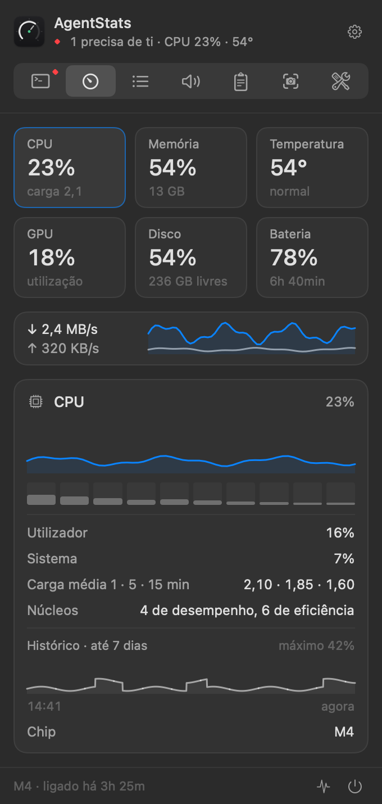
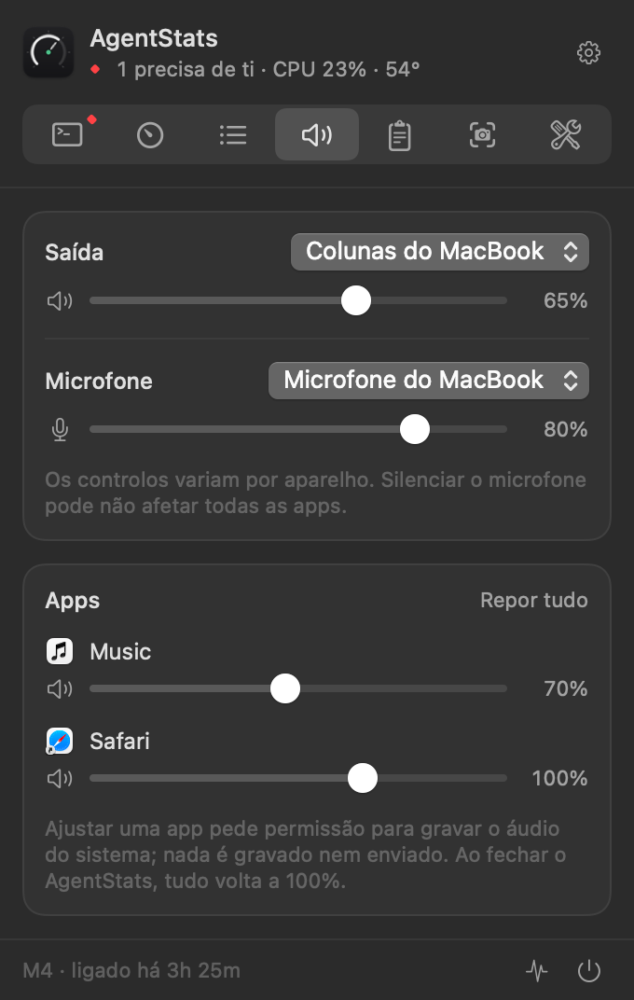
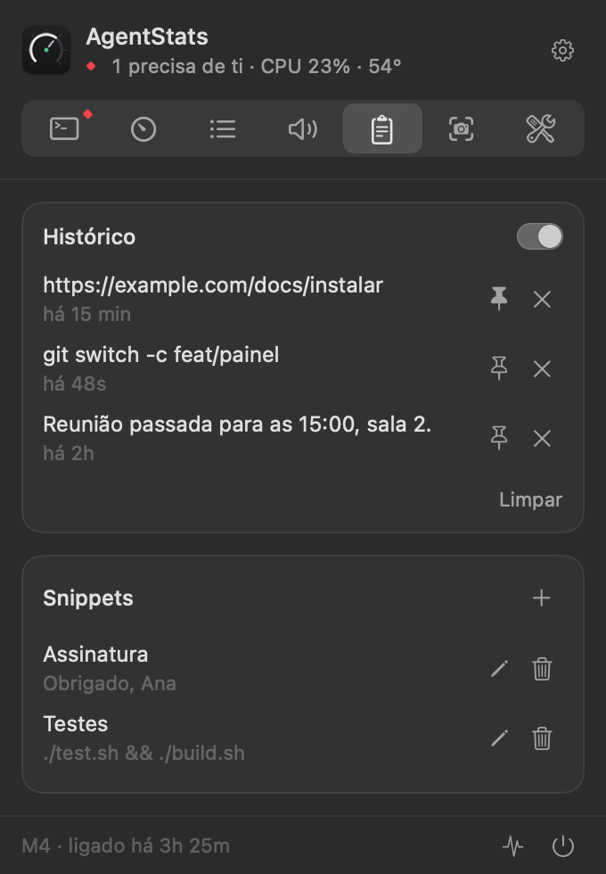
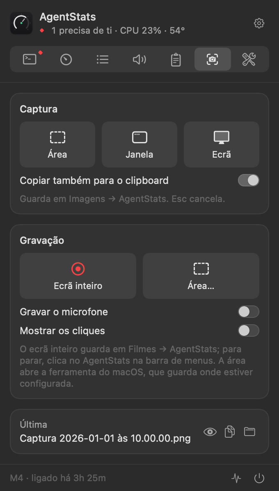
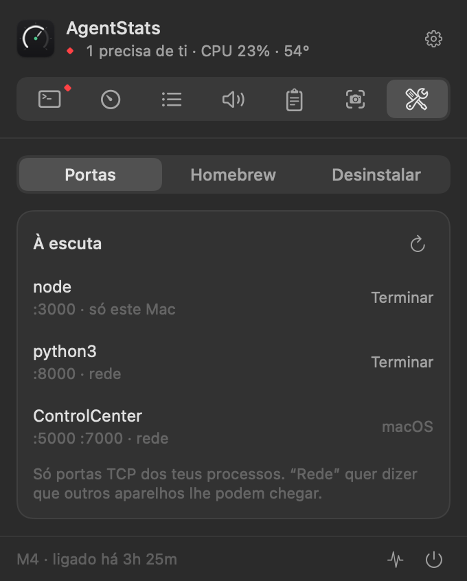

# AgentStats

[Português](README.md) · [English](README.en.md) · [Español](README.es.md) · [Français](README.fr.md)


**Agentes de IA e métricas do Mac, num só painel.** O AgentStats vive na barra de menus e mostra o que está a correr, o que precisa da tua atenção e como estão os recursos do sistema.

**[Descarregar a versão mais recente](https://github.com/HamiltonPrado/agentstats/releases/latest)** · [Website](https://hamiltonprado.github.io/agentstats) · [Reportar um problema](https://github.com/HamiltonPrado/agentstats/issues)

<p align="center">
  
</p>

<p align="center">
  
  
  
</p>

<p align="center">
  
  
  
</p>

<p align="center"><sub>Capturas com dados de demonstração.</sub></p>

## O que podes acompanhar

### Agentes de IA

- Sessões com projeto, modelo, subagentes e estado: a trabalhar, à tua espera ou a precisar de aprovação. Clica numa para voltar à app onde corre.
- Reconhece Claude Code, Codex, Copilot, Cursor Agent, OpenCode, Antigravity, Aider, Goose, Gemini CLI e Amp. O detalhe varia com o que cada um regista no Mac.
- **Limites do plano** do Claude e do Codex, com a hora de renovação.
- **Tokens e custo estimado em API** por sessão, dia e projeto, para Claude Code, Codex, Copilot e OpenCode. O custo só aparece para modelos com preço conhecido e não é o que pagas com um plano.
- Aviso quando uma tarefa longa termina ou um agente precisa de ti, com lembretes se continuar à espera.

### Sistema e processos

- CPU, memória, GPU, temperaturas, rede, disco e bateria, com histórico até 7 dias e alertas.
- Apps que gastam mais energia, processos mais pesados e pastas que ocupam mais espaço.
- Teste de velocidade manual pelo Cloudflare: cerca de **32 MB por teste**; as medições podem ser recolhidas de forma agregada.
- Não controla ventoinhas.

### Áudio

- Escolhe saída e microfone e ajusta o volume.
- **Mixer por app**, de 0 a 150% (macOS 14.2+). Só mexe nas apps que ajustares e volta a 100% ao fechar o AgentStats.

### Clipboard

- Histórico de texto, **desligado até o ligares**: 100 itens, 7 dias, com itens fixos e snippets.
- Ignora o que os gestores de passwords marcam como secreto e formatos conhecidos de chaves de API. O histórico fica neste Mac, **sem cifra**.

### Captura

- Captura uma área, uma janela ou o ecrã, e grava o ecrã inteiro com microfone e cliques opcionais. Para gravar uma área abre a ferramenta do macOS.

### Ferramentas

- **Portas:** vê o que está à escuta e termina processos teus, com confirmação.
- **Homebrew:** atualiza e remove pacotes.
- **Desinstalar:** move apps para o Lixo, com os restos que escolheres.

### À tua medida

Barra de menus configurável, atalho global, perfis, tema, cor, largura, tamanho do texto, manter o Mac acordado, início de sessão automático e suporte a VoiceOver e “Reduzir movimento”. A interface está em português.

## Permissões e privacidade

| Funcionalidade | Permissão que o macOS pode pedir |
| --- | --- |
| Avisos e alertas | Notificações |
| Mixer por app | Gravação de áudio do sistema |
| Captura e gravação | Gravação de ecrã |
| Gravar com microfone | Microfone |
| Histórico do clipboard | Colar de outras apps (macOS 15.4+) |

Não há conta nem telemetria. O AgentStats lê os registos dos agentes no Mac e não os envia. Só há rede no teste de velocidade, no Homebrew quando o usas e na consulta periódica dos limites, feita pelo teu Claude Code.

Como a app não tem Developer ID, **o macOS pode voltar a pedir estas permissões depois de cada atualização**.

## Requisitos

Mac com Apple Silicon e macOS 14 ou superior. Testada no macOS 27.2.

## Instalar

Com o [Homebrew](https://brew.sh):

```bash
brew tap hamiltonprado/agentstats https://github.com/HamiltonPrado/agentstats
brew trust hamiltonprado/agentstats
brew install --cask agentstats
```

Para atualizar, `brew upgrade --cask agentstats`. Para remover, `brew uninstall --cask agentstats` (junta `--zap` para apagar também as definições e o histórico). A app não é notarizada pela Apple: o cask tira a quarentena ao instalar, por isso abre sem o aviso do macOS.

Ou à mão:

1. Descarrega **AgentStats.zip** na [página de releases](https://github.com/HamiltonPrado/agentstats/releases/latest).
2. Descomprime o ficheiro e move `AgentStats.app` para a pasta Aplicações.
3. Abre a app. Se o macOS bloquear a primeira abertura, vai a **Definições do Sistema → Privacidade e Segurança → Abrir mesmo assim**. A app é assinada localmente e não tem assinatura de programador Apple.

Também podes instalar pela linha de comandos com o [GitHub CLI](https://cli.github.com):

```bash
tmp=$(mktemp -d) && gh release download --repo HamiltonPrado/agentstats --pattern AgentStats.zip --dir "$tmp" && ditto -x -k "$tmp/AgentStats.zip" "$tmp" && { pkill -x AgentStats 2>/dev/null || true; ditto "$tmp/AgentStats.app" /Applications/AgentStats.app && open /Applications/AgentStats.app; }
```

## Contribuir

Requer macOS 14 ou superior e as Command Line Tools do Xcode.

```bash
./build.sh
open build/AgentStats.app
```

Para executar os testes:

```bash
./test.sh
```

As contribuições são bem-vindas. Abre uma [issue](https://github.com/HamiltonPrado/agentstats/issues) para reportar um problema ou sugerir uma melhoria.

## Licença

O AgentStats é distribuído sob a [licença MIT](LICENSE). Podes usar, modificar e redistribuir o código nos termos dessa licença.

<details>
<summary>Detalhes de desenvolvimento</summary>

### Criar uma release

Atualiza `VERSION` e envia uma tag com a mesma versão, por exemplo:

```bash
git tag v1.17
git push origin v1.17
```

O GitHub Actions valida a versão, executa os testes, compila a app e publica `AgentStats.zip` na release.

### Diagnóstico

- `AgentStats --dump` — métricas e agentes detetados.
- `AgentStats --bench` — tempo de execução dos leitores.
- `AgentStats --snapshot <pasta>` — capturas do painel em PNG, só com dados inventados.
- `AgentStats --smoke` — teste de arranque, com os leitores reais.
- `AGENTSTATS_DISABLE=icon,temps,procs,sessions,usage,energy,limits,gpu,disk` — desativa leitores para medir consumo.

### Arquitetura

O `Sampler` (actor) coordena as leituras e devolve uma amostra imutável. O `Monitor` aplica os dados no main actor; as vistas SwiftUI observam apenas o estado que utilizam. O projeto usa Swift 6 com verificação de concorrência.

</details>
