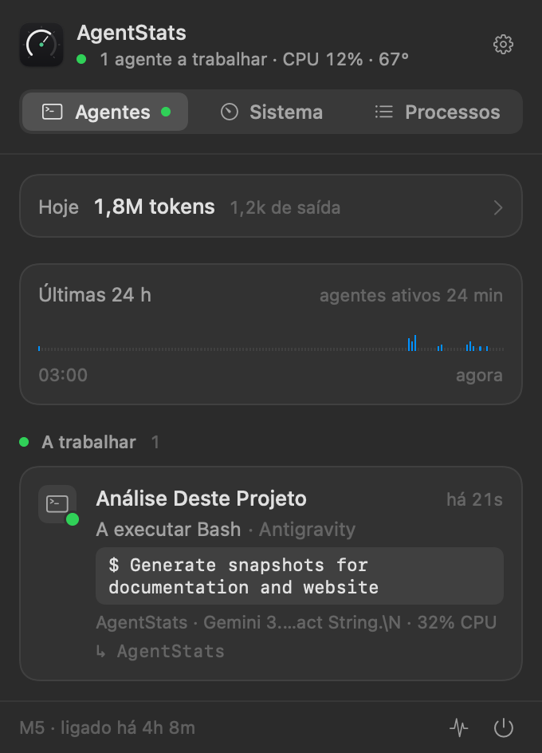

# AgentStats

[](https://github.com/HamiltonPrado/agentstats/actions/workflows/ci.yml)
[](https://github.com/HamiltonPrado/agentstats/releases)


App de barra de menus para macOS (estilo Stats) que mostra as métricas do sistema e os agentes de IA a trabalhar em tempo real.

🌐 **Website oficial:** [hamiltonprado.github.io/agentstats](https://hamiltonprado.github.io/agentstats)

<p align="center">
  <br>
  <em>Barra de menus compacta e rasterizada em CoreText (custo de CPU ~0%).</em>
</p>

<p align="center">
  
  &nbsp;&nbsp;
  
</p>

## Funcionalidades
- **Barra de menus:** agentes a trabalhar/total, CPU, RAM, temperatura, GPU, rede e bateria (configurável)
- **Agentes:** sessões em tempo real do **Claude Code**, **Codex** (CLI e app ChatGPT), **Antigravity** (Google DeepMind), **Aider**, **Goose**, **Gemini CLI**, **Cursor Agent**, **OpenCode** e **Amp** com estado imediato (a executar ferramenta, a pensar, à espera), projeto, modelo, CPU/RAM, subprocessos e subagentes. Notificação quando um agente termina.
- **Temperaturas:** CPU (média e máx.), chip, SSD e bateria via sensores HID do Apple Silicon — sem precisar do Xcode
- **Sistema:** CPU (total, por núcleo, carga, estado térmico), memória (apps, wired, comprimida, cache, swap, pressão), GPU, rede, disco e bateria
- **Teste de velocidade:** teste manual de download, upload e latência no separador Rede (cerca de 32 MB por teste, através do Cloudflare)
- **Precisa de ti:** deteta quando um agente do Claude Code está bloqueado à espera de aprovação (Bash/Edit/Write) ou tem uma pergunta para ti; destaca a vermelho, ✋ na barra de menus e notificação
- **Hook do Claude Code:** com `AgentStats --hook` no hook `Notification` de `~/.claude/settings.json`, o "precisa de aprovação" passa a vir do próprio Claude Code (sem hook, usa uma heurística). Exemplo:
  ```json
  { "hooks": { "Notification": [ { "hooks": [ { "type": "command", "command": "/Applications/AgentStats.app/Contents/MacOS/AgentStats --hook 2>/dev/null || true", "async": true, "timeout": 10 } ] } ] } }
  ```
- **Ir para o agente:** clicar num cartão ou numa notificação traz para a frente a app onde o agente corre (Claude, Terminal, VS Code…; Codex → app ChatGPT)
- **Histórico de 24 h:** um ponto por minuto (CPU, memória, temperatura, agentes a trabalhar), guardado em `~/Library/Application Support/AgentStats/history.json`; faixa de atividade dos agentes e gráficos de 24 h no Sistema
- **Atalho global:** ⌥⌘A abre e fecha o painel em qualquer app (configurável nas Definições: ⌃⌥A, ⌥⌘S ou desligado)
- **Acessibilidade:** estado dos agentes por cor e forma (cheio, anel, losango, traço), descrições para o VoiceOver (cartões, leituras, gráficos, ícone da barra de menus) e respeito pela opção "Reduzir movimento"
- **Tokens:** total de hoje (Claude + Codex) e por sessão; ao clicar, os últimos 7 dias e os projetos que mais gastaram. Lido incrementalmente dos transcripts
- **Alertas:** notificação quando a CPU ou a temperatura ficam 20 s acima do limite (configurável), com o processo mais pesado; aviso ⚠ na barra de menus
- **Processos:** top por CPU
- Abrir ao iniciar sessão

## Instalar sem clonar

Com o [GitHub CLI](https://cli.github.com) (`gh`) com sessão iniciada, instala a última versão publicada:

```bash
tmp=$(mktemp -d) && gh release download --repo HamiltonPrado/agentstats --pattern AgentStats.zip --dir "$tmp" && ditto -x -k "$tmp/AgentStats.zip" "$tmp" && { pkill -x AgentStats; ditto "$tmp/AgentStats.app" /Applications/AgentStats.app && open /Applications/AgentStats.app; }
```

Descarregada pelo `gh`, a app não fica em quarentena e abre sem aviso. Descarregada pelo browser (Releases → AgentStats.zip), o macOS bloqueia-a da primeira vez: Definições do Sistema → Privacidade e Segurança → **Abrir mesmo assim** (a app é assinada localmente, sem conta de programador Apple).

## Publicar uma versão

1. Atualiza o ficheiro `VERSION` (ex.: `1.9`) e faz commit
2. `git tag v1.9 && git push origin v1.9`

A CI testa, compila e cria a Release com `AgentStats.zip`. Se a tag não corresponder ao `VERSION`, a publicação falha.

## Compilar
Requer macOS 14+ e as Command Line Tools (`xcode-select --install`).

```bash
./build.sh
open build/AgentStats.app
```

Diagnóstico sem interface: `build/AgentStats.app/Contents/MacOS/AgentStats --dump`

## Testes
Swift Testing (45 testes: leitura de transcripts do Claude e do Codex, deteção de "precisa de aprovação", contagem de tokens, formatação):

```bash
./test.sh
```

## Integração contínua
Cada push para `main` compila e testa no GitHub Actions (`.github/workflows/ci.yml`). A app compilada fica em Actions → execução → Artifacts (`AgentStats-<commit>`, 30 dias).

## Arquitetura
- `Sampler` (actor) é dono de todos os leitores e devolve uma `Sample` imutável (`Sendable`) por volta
- `Monitor` (`@Observable`, main actor) aplica cada amostra; as vistas só redesenham o que leem
- Modo de linguagem Swift 6 (segurança contra data races verificada pelo compilador)

## Ícone
Gerado por código em `Scripts/make-icon.swift` → `Resources/AppIcon-1024.png`; o `build.sh` converte-o em `.icns`.

```bash
swiftc -O Scripts/make-icon.swift -o /tmp/make-icon && /tmp/make-icon Resources/AppIcon-1024.png
```

## Diagnóstico
- `AgentStats --dump` — métricas e agentes detetados
- `AgentStats --bench` — custo (ms) de cada leitor
- `AgentStats --snapshot <pasta>` — renderiza o painel em PNG (`AGENTSTATS_FAKE_ALERT=1` simula alertas e um pedido de aprovação)
- `AGENTSTATS_DISABLE=icon,temps,procs,sessions,usage,gpu,disk` — desliga partes para medir o consumo
- `AGENTSTATS_OPEN_PANEL=1` — abre o painel ao arrancar (para medir o consumo com ele aberto)
